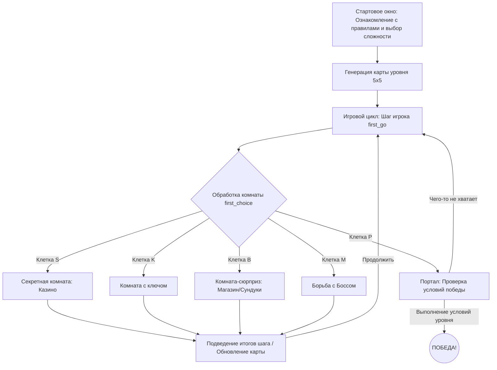

!!!!!!!!!!!!!!!!!ДАННЫЙ ФАЙЛ README НАПИСАН НА ОСНОВЕ НАПИСАННОЙ МНОЙ ИГРЫ(НА ОСНОВЕ ФАЙЛОВ). ДИАГРАММУ И ИГРУ ДЕЛАЛ САМ 

# Текстовая RPG-игра: Подвалы МИСИСа 🎮

Приключенческая консольная ролевая игра на **Python**, в которой игроку предстоит исследовать процедурно генерируемые подземелья, собирать экипировку, испытывать удачу в казино и сразиться с финальным боссом, чтобы сбежать через портал.

## 🗺️ Игровая логика и структура проекта

Архитектура игры построена на основе модульной системы комнат и динамической генерации карты. Ниже представлена схема переходов и взаимодействия игровых систем:



---

## ⚙️ Уровни сложности

Перед началом игры пользователь знакомится с правилами выживания в лабиринте и выбирает один из трех уровней сложности:

*   **1 — Простой уровень:** Много доступного снаряжения, мало опасных боссов. Для успешного побега необходим **1 ключ**.
*   **2 — Средний уровень:** Сбалансированное количество экипировки и противников. Для прохождения требуется собрать **2 ключа**.
*   **3 — Сложный уровень:** Жесткий дефицит ресурсов и высокая плотность боссов. Для победы нужно отыскать **3 ключа**.

---

## 🚀 Описание ключевых механик комнат

*   **Динамическая генерация уровней:** Карта представляет собой сетку `5x5`, которая каждый раз создается случайным образом. Комнаты (секреты, боссы, сундуки, порталы) распределяются так, чтобы не накладываться друг на друга.
*   **Система комнат и событий:**
    *   **`M` (Monster/Boss)** — Битва с Боссом, обитающим в подвале МИСИСа. Победа зависит от суммарного урона вашего оружия и наличия защитных зелий.
    *   **`S` (Secret Room)** — Секретная комната с полноценным Казино. Можно сыграть в "Ставки" на снаряжение или в числовую игру "20-25" для заработка монет.
    *   **`B` (Box/Shop)** — Комната-сюрприз, где можно бесплатно получить предмет, улучшить текущий меч заточенным лезвием или закупиться в магазине.
    *   **`K` (Key)** — Комната, в которой игрок подбирает ключ. Посетить её можно только один раз (после чего клетка блокируется).
    *   **`P` (Portal)** — Финальная точка. Выйти из уровня можно только при выполнении квестовых условий (сбор ключей и трофеев).

---

## 📁 Структура файлов проекта

*   **`main.py`** — Главный управляющий файл. Запускает стартовое меню, инициализирует генерацию карты и крутит основной цикл игры `while game_running`.
*   **`start_window_package/`** (Пакет инициализации):
    *   `start_window.py` — Приветственное окно, вывод правил лабиринта и обработка выбора сложности (возвращает уровень 1, 2 или 3).
    *   `generate.py` — Алгоритмы случайной расстановки объектов на координатной сетке.
*   **`first_level/`** (Пакет логики первого уровня):
    *   `first_go.py` — Перемещение игрока (`W`, `A`, `S`, `D`), отрисовка положения `X` на карте и валидация выхода за границы лабиринта.
    *   `first_choice.py` — Диспетчер комнат. Проверяет текущие координаты игрока и запускает соответствующий скрипт события.
    *   `first_boss.py` — Логика расчета боя с боссом (учет урона меча, палки-ковырялки, камней и модификатора лезвия).
    *   `first_box.py` — Логика сундуков с подарками и механика работы магазина снаряжения.
    *   `first_key.py` — Скрипт выдачи ключа и модификации посещенной клетки на заблокированную.
    *   `first_portal.py` — Триггер проверки условий завершения игры в портале.
    *   `first_room_with_secret.py` — Модуль азартных игр (Казино) с механиками ставок и риском проиграть экипировку.

---

## 🛠️ Системные требования и запуск

Для запуска игры необходим установленный интерпретатор **Python 3.x**. Дополнительных внешних зависимостей не требуется (используются встроенные модули `random`).

1. Скачайте или клонируйте репозиторий с проектом.
2. Откройте терминал в папке проекта.
3. Запустите игру командой:
   ```bash
   python main.py
   ```

---

## ⚔️ Таблица снаряжения и предметов

| Предмет | Тип / Свойство | Эффект / Стоимость |
| :--- | :--- | :--- |
| **Sword (Меч)** | Оружие | +70 урона / Покупка: 50 монет |
| **Stone (Камень)** | Оружие | +30 урона |
| **Kovyryalka (Палка)** | Оружие | +20 урона / Покупка: 10 монет |
| **Sharpened blade** | Модификатор | Удваивает общий урон оружия |
| **Heal (Зелье)** | Расходник | Защищает от смертельного удара босса / Покупка: 40 монет |
| **Key (Ключ)** | Квестовый | Необходим для открытия Портала |
| **Boss_ring (Кольцо)** | Квестовый | Выпадает с Босса, открывает Портал |
